  

# 🛡️ Awesome Full SaaS Data Resiliency Cloud

  
  
  
  
  
  

> 🌐 A comprehensive, production-grade curated list of **100% SaaS Data Resiliency Cloud** platforms, cloud-native backup engines, ransomware cyber-recovery solutions, and self-hosted open-source data protection frameworks.

---

## 📈 Sector Overview & Market Dynamics

The global **Data Protection as a Service (DPaaS)** and **Cloud Data Resiliency** market is estimated at **$22B–$38B**, with dedicated **Backup-as-a-Service (BaaS)** accounting for **$8B–$11B** and compounding at over 15–30% CAGR through 2030, accelerated by enterprise multi-cloud sprawl and mandatory ransomware recovery SLAs. The sector exhibits **moderate fragmentation with rapid platform consolidation**: enterprise data estates and hybrid environments are gravitating toward a concentrated tier of scale leaders (Veeam, Rubrik, Cohesity/Veritas, Commvault), while agile pure-SaaS platforms and self-hosted open-source storage engines address specific sovereign, niche cloud, and zero-egress workloads.

---

## 📑 Table of Contents

- [☁️ SaaS / Hosted Platforms](#-saas--hosted-platforms)
- [💻 Open-Source GitHub Projects](#-open-source-github-projects)
- [⚖️ Comparison: SaaS vs. Self-Hosted Open-Source](#-comparison-saas-vs-self-hosted-open-source)
- [⭐ Star History](#-star-history)
- [🤝 Support](#-support)
- [🚀 How to Contribute](#-how-to-contribute)
- [⚠️ Disclaimer](#-disclaimer)

---

## ☁️ SaaS / Hosted Platforms

Leading enterprise SaaS data resiliency cloud providers sorted by company size (valuation / ARR / market cap descending):

| Product | 🏢 Company Size (Valuation / ARR / Market Cap) | 💰 Starting Price (Specific Tier) | ⏱️ Free Tier / Trial Limits | 📝 Description |
|:---|:---|:---|:---|:---|
| **[Veeam Data Cloud](https://www.veeam.com/)** | **~$15B Valuation** ($1.7B+ ARR; backed by TPG/Insight Partners) | **$2.63 / user / month** (M365 Foundation, annual commitment); Advanced tier at **$3.33/user/mo**; Veeam Vault storage add-on at **$14/TB/mo** (Archive) or **$24/TB/mo** (Standard) | **30-day free trial**; Microsoft Azure workload trial capped at **10 TB of storage**; full access without commercial usage rights | Fully managed SaaS backup with unlimited M365 storage included. Protects Exchange, SharePoint, OneDrive, Teams, and Azure with immutable cloud vaulting and Entra ID resilience. |
| **[Rubrik Security Cloud](https://www.rubrik.com/)** | **~$11B–$14B Market Cap** ($1.31B FY25 revenue, $1.09B subscription ARR, NYSE: RBRK) | **$156,000 / year** list (Foundation tier entry for 100 BETB baseline on 3-year commitment); utility reserve capacity models available | **30-day free trial** for SaaS offerings: M365 trial limited to **max 500 users and 10 TB capacity**; Google Workspace trial limited to **max 10 users and 500 GB capacity** | Zero-trust enterprise cyber resilience platform providing immutable backups, automated threat hunting, blast-radius analysis, and orchestrated ransomware recovery. |
| **[Cohesity Cloud Services](https://www.cohesity.com/)** | **~$8B Valuation** ($1.7B+ pro forma revenue post-Veritas DP combination) | **$69.00 / month** (M365 Core Protection starting tier via AWS/Azure marketplace, 80 FETB / 1 user baseline); Enterprise multicloud BaaS scales via metered credits | **30-day free trial**; full access to Cohesity DataProtect BaaS for AWS/Azure/M365 workloads; trial length variable per regional partner | AI-powered multicloud data security and BaaS platform covering hybrid environments, enterprise virtual machines, databases, and SaaS collaboration applications. |
| **[Commvault Cloud](https://www.commvault.com/)** | **~$7.2B Market Cap** ($995.6M FY25 revenue, NASDAQ: CVLT) | **$937.00 / TB / month** (Metallic Cloud Storage Cool Tier list on 1-month commitment); M365 backup starting at **~$3.25 / user / month** | **30-day free trial**; cloud marketplace subscriptions provisioned with **30,000 evaluation credits** to benchmark FETB+ consumption across workloads | SaaS-delivered cyber resiliency and backup powered by Metallic engine, featuring air-gapped Cloud Storage, Active Directory resilience, and automated cleanroom recovery. |
| **[Acronis Cyber Protect Cloud](https://www.acronis.com/)** | **~$4B Valuation** ($420M+ ARR; backed by EQT and BlackRock) | **$0.07 / GB / month** (starting cloud storage rate under per-GB model); workstation backup starting at **~$3.00 / workstation / month** via service provider rate card | **30-day free trial**; full platform access for MSP/enterprise customer tenants with active ransomware rollback engine | Integrated cyber protection platform uniting cloud backup, disaster recovery, continuous data protection (CDP), and AI-driven anti-ransomware remediation. |
| **[Druva Data Resiliency Cloud](https://www.druva.com/)** | **~$2B Valuation** ($200M+ ARR) | **$2.50 / user / month** (inSync Microsoft 365 / Google Workspace baseline); credit-based data center storage starting at **~$30–$40 / TB / month** after deduplication | **30-day free trial** (extendable to a **maximum of 60 days** for partner evaluations); no credit card required; includes live onboarding checklists | 100% SaaS data protection platform built natively on AWS with global source-side deduplication, zero-egress restore charges, and automated disaster recovery orchestration. |
| **[Keepit](https://www.keepit.com/)** | **~$391M Valuation** ($100M+ ARR) | **$2.60 / user / month** (Business Essentials tier for M365/Google Workspace on annual commitment); Enterprise Unlimited tier at **$4.00/user/mo** | **30-day evaluation Proof of Concept (POC)** available via sales onboarding; mandatory 30-day security hold on deleted accounts | Vendor-independent, cloud-dedicated backup for Microsoft 365, Google Workspace, Salesforce, and Azure Entra ID with 4 immutable data copies distributed across independent cloud infrastructure. |
| **[HYCU Protégé](https://www.hycu.com/)** | **~$350M–$500M Valuation** (~$58M ARR, $140M funding raised) | **$1.20 / user / month** (Workforce Identity Suite for Okta/Entra ID); **$2.25 / user / month** (Microsoft 365 Suite); Starter VM bundles from **$5,000 / year** | **14-day free trial** standard across HYCU R-Cloud and Azure (promotional 30-day trials for Okta/Entra ID); unmetered software trial (cloud compute/storage egress billed by host hyperscaler) | Purpose-built multi-cloud data protection and R-Cloud marketplace supporting 100+ SaaS services, PaaS offerings, Nutanix, AWS, Azure, and Google Cloud workloads. |
| **[Clumio (Commvault)](https://www.commvault.com/)** | **Acquired subsidiary** (Commvault Systems, Inc.) | **$0.025 / GiB / month** (Amazon S3 backup); DynamoDB protection at **$0.15 / GiB / month**; Aurora snapshots at **$0.030 / GiB / month** | **14-day free trial** on AWS and Google Cloud Marketplaces; Google Cloud Marketplace trial capped at **14 days or $2,500 total usage credits** | Serverless, high-scale backup and recovery engine tailored for high-volume Amazon S3 buckets, cloud databases, and AWS native environments with air-gapped vaulting. |

---

## 💻 Open-Source GitHub Projects

Self-hosted data protection systems, encrypted backup engines, and Kubernetes disaster recovery orchestrators sorted by GitHub stargazers count descending:

| Project | ⭐ Star Badge | 📊 Star Count | 🛠️ Architecture & Storage Backends | 📜 License | 📝 Description |
|:---|:---:|:---:|:---|:---|:---|
| **[Rclone](https://github.com/rclone/rclone)** |  | 61,000+ | CLI, VFS mount, FUSE, REST API; 70+ cloud backends (S3, B2, Azure, Drive, SFTP) | MIT | The "Swiss Army knife" of cloud data sync and multi-cloud resiliency. Powers data replication, bandwidth throttling, and encrypted mirroring across cloud-native environments. |
| **[Restic](https://github.com/restic/restic)** |  | 37,200+ | Golang, Content-Defined Chunking, AES-256 CTR, Poly1305-AES; S3, B2, Azure, GCS, SFTP | BSD-2-Clause | Foundational secure backup engine featuring cryptographic deduplication, end-to-end encryption, and snapshot isolation without external daemon dependencies. |
| **[Duplicati](https://github.com/duplicati/duplicati)** |  | 15,200+ | C# / .NET, Web UI, Tray Icon, AES-256; S3, OneDrive, Google Drive, Backblaze B2, WebDAV | LGPL-2.1 | Block-based encrypted backup software with a built-in web management console, granular scheduler, incremental backup deduplication, and multi-destination redundancy. |
| **[Kopia](https://github.com/kopia/kopia)** |  | 14,700+ | Go, CLI, GUI, Repository Server, Content-Addressed Storage; AWS S3, Azure Blob, GCP, B2, SFTP | Apache-2.0 | High-performance fast backup and restore tool featuring zero-knowledge client-side encryption, deduplication, compression (zstd/snappy), and a built-in multi-user repository server. |
| **[BorgBackup](https://github.com/borgbackup/borg)** |  | 13,900+ | Python/C, Deduplicated Chunking, HMAC-SHA256, authenticated encryption; SSH/Local storage | BSD-3-Clause | Enterprise-grade deduplicating backup engine with verified authenticated encryption, bandwidth-efficient offsite SSH transport, and automated snapshot pruning. |
| **[Velero](https://github.com/vmware-tanzu/velero)** |  | 10,300+ | Kubernetes CRDs, Controller daemon, CSI Volume Snapshots; S3, Azure Blob, Google Cloud Storage | Apache-2.0 | Standard cloud-native disaster recovery orchestrator for Kubernetes clusters; backs up and restores etcd resources and persistent application volumes across clusters and cloud regions. |
| **[Longhorn](https://github.com/longhorn/longhorn)** |  | 8,000+ | Kubernetes Microservices, Distributed Block Storage Engine; S3, NFS targets | Apache-2.0 | CNCF-incubated cloud-native distributed block storage system providing cross-region synchronous replication, scheduled volume snapshots, and automated disaster recovery. |
| **[Backrest](https://github.com/garethgeorge/backrest)** |  | 7,900+ | Web UI, Go REST daemon, Restic Orchestrator; S3, MinIO, B2, Azure, local storage | GPL-3.0 | Modern web-based management UI and orchestrator for Restic repositories, offering scheduled plan executions, snapshot browsers, multi-repository aggregation, and Discord/Slack alerts. |
| **[WAL-G](https://github.com/wal-g/wal-g)** |  | 4,300+ | Golang, Continuous WAL Archiving, Delta Backups; S3, Google Cloud Storage, Azure Blob | Apache-2.0 | Cloud-native archival, continuous WAL streamer, and point-in-time recovery (PITR) engine designed for high-throughput databases (PostgreSQL, MySQL, MongoDB, Redis). |
| **[Plakar](https://github.com/plakarkorp/plakar)** |  | 2,100+ | Go, Kloset Encrypted Container, Passphrase-Derived Key Architecture; S3, NAS, Local FS, Tape | ISC | Modern auditable resilience engine featuring end-to-end client encryption, audited zero-knowledge architecture, deduplicated multi-destination snapshots, and granular verifiable restores. |
| **[Kanister](https://github.com/kanisterio/kanister)** |  | 800+ | Kubernetes Operator, Custom Blueprints, Go; Cloud Object Storage (S3, GCS, Azure) | Apache-2.0 | Extensible framework for application-level data management on Kubernetes, enabling application-consistent database backups, cross-region migration, and automated failover workflows. |

---

## ⚖️ Comparison: SaaS vs. Self-Hosted Open-Source

| Capability / Factor | ☁️ 100% Pure SaaS Cloud (e.g., Veeam, Druva, Rubrik) | 💻 Self-Hosted Open-Source (e.g., Restic, Backrest, Plakar) |
|:---|:---|:---|
| **Infrastructure Overhead** | Zero infrastructure footprint; fully managed cloud control and data planes. | Self-hosted compute daemon/container and independently provisioned object storage. |
| **Pricing Predictability** | Per-user seat tiers ($1.20–$7.00/mo) or per-TB consumption ($25–$150+/TB/mo); risk of cost sprawl. | Zero software licensing fees; cost bounded strictly by underlying commodity cloud storage ($0.004–$0.015/GB/mo on S3/Wasabi/B2). |
| **Ransomware Cyber Vaults** | Turnkey air-gap vaults, cleanroom recovery, and AI-powered anomaly detection included. | Requires manual architecture of immutable WORM buckets (S3 Object Lock) and KMS key rotation. |
| **SaaS Application Protection** | Native direct API connectors for Microsoft 365, Google Workspace, Salesforce, and Entra ID. | Requires custom API scraping scripts, third-party adapters, or database dump pipelines. |
| **Data Sovereignty & Auditing** | Subject to vendor trust boundaries and SaaS tenant isolation standards (SOC2, FedRAMP). | Complete sovereign control; source code auditable under ISC, MIT, Apache-2.0, or BSD licenses. |

---

##  Star History

---

## 💖 Support

Thank you so much for exploring and using this repository! If you found this curated guide helpful in navigating the cloud data resiliency and cyber recovery ecosystem:

- ⭐ **Star this repository** to help others discover it.
- 🍴 **Fork and contribute** to keep the pricing and tooling directory accurate and updated.
- 📢 **Share with colleagues, SREs, and DevOps communities**.
- ☕ **Support future maintenance and open-source curation**:  
  

---

## 🚀 How to Contribute

1. Fork this repository.
2. Add or update entries in `README.md` following the tabular column structures.
3. For SaaS platforms: Include verified starting tier pricing and specific trial limits.
4. For Open-Source projects: Include star badges linked to stargazers and correct repository metrics.
5. Submit a pull request with reference documentation.

---

## ⚠️ Disclaimer

- This is a community-curated technical directory; listings do not represent commercial endorsements.
- Always verify data isolation, encryption at rest/in transit, and scheduled recovery validation before deploying production workloads.
